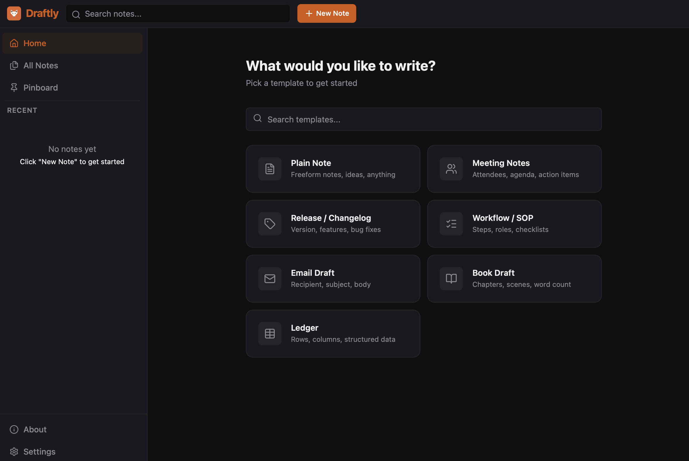

<div align="center">


# Draftly

**A local-first, privacy-native note-taking app for your desktop — with AI writing help built in.**

Free. Open source. Fully vibe-coded.

[](https://github.com/kashifkhan0771/draftly/releases/latest)
[](https://github.com/kashifkhan0771/draftly/releases)
[](https://github.com/kashifkhan0771/draftly/actions/workflows/ci.yml)
[](LICENSE)
[](#-install)
[](#-fully-vibe-coded)

[**Download**](https://github.com/kashifkhan0771/draftly/releases/latest) ·
[**Features**](#-features) ·
[**Install**](#-install) ·
[**Build from source**](#%EF%B8%8F-build-from-source) ·
[**Report a bug**](https://github.com/kashifkhan0771/draftly/issues/new?template=bug_report.md)

<br>



</div>

---

## Why Draftly?

Most note apps want an account, a subscription, and your data on their servers. Draftly doesn't.

- **Your notes never leave your machine.** Everything lives in a local SQLite file.
- **No account, no tracking, no telemetry.** Open the app and start writing.
- **Start from structure, not a blank page.** Seven templates for meetings, changelogs, SOPs, emails, books, and more.
- **AI when you want it, never when you don't.** Bring your own key from Claude, Gemini, Grok, or Groq — or leave AI off and stay fully offline.
- **Free forever.** MIT licensed. Every feature is available to everyone.

---

## ✨ Features

| | |
|---|---|
| 📝 **Note templates** | Plain Note, Meeting Notes, Release / Changelog, Workflow / SOP, Email Draft, Book Draft, Ledger |
| 🤖 **AI writing assistant** | Rewrite a selection in six tones (Professional, Casual, Formal, Friendly, Concise, Creative) or summarize it |
| 🔑 **Bring your own AI key** | Claude (Anthropic), Gemini (Google), Grok (xAI), Groq — your key, your provider, your bill |
| 🎨 **Five themes** | 🦊 Fox · 🐦‍⬛ Raven · 🦌 Moose (dark) and 🐧 Penguin · 🐻‍❄️ Polar Bear (light) |
| 📌 **Pinboard** | Pin important notes for one-click access |
| 🗂️ **All Notes view** | Every note as a card, with type filters, search, and sorting |
| 🔍 **Full-text search** | Search across all your notes from the sidebar |
| 📄 **PDF export** | Export any note to a formatted PDF |
| ☁️ **Google Drive backup** | Optional backup and restore to *your own* Drive — straight from your machine to Google, no middle server |
| ✍️ **Rich text editor** | Powered by Tiptap, with adjustable font size (12–24 px) |
| 🔔 **Update notifications** | A small banner tells you when a new release is out. Nothing is downloaded or installed for you |

---

## 📦 Install

Grab the file for your system from the [**latest release**](https://github.com/kashifkhan0771/draftly/releases/latest).

| Platform | File |
|---|---|
| Ubuntu / Debian / Mint | `draftly_VERSION_amd64.deb` |
| Other Linux distros | `draftly-linux-amd64.tar.gz` |
| macOS (Apple Silicon + Intel) | `draftly-macos-universal.zip` |
| Windows 10 / 11 | `draftly-windows-amd64.exe` |

### Linux — Ubuntu / Debian / Mint

```bash
sudo apt install ./draftly_VERSION_amd64.deb
```

Draftly then appears in your app launcher. Running `draftly` from a terminal also works and prints any startup errors.
Needs Ubuntu 22.04+ or Debian 12+ (for `libwebkit2gtk-4.1`).

### Linux — other distros

Install the runtime libraries, then put the binary on your path:

```bash
# Fedora
sudo dnf install gtk3 webkit2gtk4.1
# Arch
sudo pacman -S gtk3 webkit2gtk-4.1

tar -xzf draftly-linux-amd64.tar.gz
mkdir -p ~/.local/bin && mv draftly ~/.local/bin/
~/.local/bin/draftly
```

On first launch Draftly adds itself to your app launcher.

### macOS

1. Unzip `draftly-macos-universal.zip` and move `draftly.app` into **Applications**.
2. Draftly isn't signed with a paid Apple Developer certificate, so macOS blocks it the first time. Clear the quarantine flag once:

   ```bash
   xattr -dr com.apple.quarantine /Applications/draftly.app
   ```

3. Open Draftly from Launchpad or Applications.

### Windows

Download `draftly-windows-amd64.exe` and run it — no installer needed. Draftly uses Microsoft Edge WebView2, which comes with Windows 10 and 11.

Windows may show a SmartScreen warning because the app isn't code-signed. Click **More info → Run anyway**.

---

## 🔄 Update

Draftly shows a banner when a new version is available. Your notes are stored separately from the app, so updating never touches them.

| Install type | How to update |
|---|---|
| `.deb` | `sudo apt install ./draftly_NEW_VERSION_amd64.deb` |
| Tarball | Replace `~/.local/bin/draftly` with the new binary |
| macOS | Quit Draftly, replace `/Applications/draftly.app`, run the `xattr` command again |
| Windows | Quit Draftly and replace the `.exe` with the new one |

---

## 🗑️ Uninstall

Removing the app keeps your notes. Delete the data folder too if you want them gone — **this is permanent**.

**Linux**

```bash
sudo apt remove draftly                 # .deb install
rm ~/.local/bin/draftly                 # tarball install

rm -f ~/.local/share/applications/draftly.desktop
rm -f ~/.local/share/icons/hicolor/512x512/apps/draftly.png
rm -rf ~/.config/draftly                # your notes and settings
```

**macOS**

```bash
rm -rf /Applications/draftly.app
rm -rf ~/Library/Application\ Support/draftly   # your notes and settings
```

**Windows**

Delete `draftly-windows-amd64.exe`. To remove your notes and settings too, delete the `%AppData%\draftly` folder.

---

## 🔒 Privacy

| What | Where it goes |
|---|---|
| Your notes and settings | A local SQLite file on your machine. Nowhere else. |
| AI features | Only the text you select, only to the provider you picked, using your own key |
| Google Drive backup | Only if you turn it on, to your own Drive, via Google OAuth |
| Update check | One request to the GitHub releases API on launch |

No accounts. No analytics. No telemetry.

---

## 🛠️ Build from source

```bash
git clone https://github.com/kashifkhan0771/draftly.git
cd draftly
make dev
```

You'll need Go, Node.js, and the Wails CLI. Google Drive backup in your own builds needs your own Google OAuth credentials. See [CONTRIBUTING.md](CONTRIBUTING.md) for the full setup and build steps.

---

## 🤖 Fully vibe-coded

Draftly is **100% vibe-coded**: it was built by describing what I wanted to AI coding assistants and steering the result, not by writing every line by hand. It started life as a paid app; it's now free and open source so anyone can use it, learn from it, or make it better.

That also means: if something looks odd in the code, it might be! Issues and pull requests that clean things up are very welcome.

---

## 🤝 Contributing

Bug reports, ideas, and pull requests are all welcome.

- 🐛 [Report a bug](https://github.com/kashifkhan0771/draftly/issues/new?template=bug_report.md)
- 💡 [Request a feature](https://github.com/kashifkhan0771/draftly/issues/new?template=feature_request.md)
- 🔧 Read [CONTRIBUTING.md](CONTRIBUTING.md) before opening a pull request

If you like Draftly, a ⭐ on GitHub helps other people find it.

---

## 🙏 Built with

[Wails](https://wails.io) · [React](https://react.dev) · [Tiptap](https://tiptap.dev) · [Tailwind CSS](https://tailwindcss.com) · [Zustand](https://github.com/pmndrs/zustand) · [Lucide](https://lucide.dev) · [modernc SQLite](https://gitlab.com/cznic/sqlite) · [gofpdf](https://github.com/jung-kurt/gofpdf)

---

## 📄 License

Draftly is released under the [MIT License](LICENSE). © 2026 Kashif Khan.
